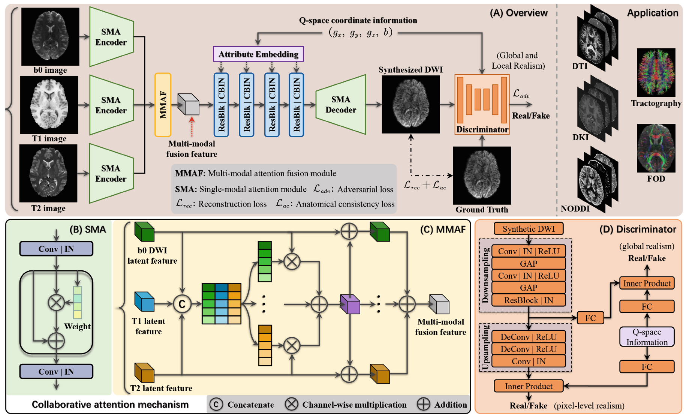

# Q-CATN

PyTorch implementation of **Q-Space Guided Collaborative Attention Translation Network for Flexible Diffusion-Weighted Images Synthesis**, presented at MICCAI 2025. [Paper](https://doi.org/10.1007/978-3-032-04947-6_48)

Q-CATN synthesizes diffusion-weighted images from b0, T1-weighted, and T2-weighted MRI, conditioned on the desired b-vector and b-value. Collaborative attention integrates complementary information across modalities, while q-space conditioning supports flexible diffusion sampling.



*Figure 1. Q-CATN overview, single-modal attention (SMA), multi-modal attention fusion (MMAF), and the conditional discriminator.*

## Dependencies

Original environment: Python 3.8 and PyTorch 1.13.0. Inference requires an NVIDIA GPU with CUDA.

```bash
pip install torch==1.13.0 torchvision==0.14.0 Pillow==9.4.0 nibabel==4.0.2 h5py==3.8.0 numpy==1.21.5 scipy==1.7.3 PyYAML
```

Use a PyTorch build compatible with your CUDA environment. PyYAML is required to read `configs/qspace.yaml`.

## Training and Testing

### Training

The current release provides the generator, configuration, and inference utilities, but does not include a complete training loop, training data loader, or training command. `mains/trainer.py` initializes the generator for inference. Refer to the paper for the training method and losses.

### Inference

1. Place your trained generator checkpoint at `checkpoint/gen.pt`. The script expects its state dictionary under the key `a`.
2. Place the input data at `dataset/test.h5`, containing `b0`, `t1`, `t2`, `bvec`, and `bval`. A [demo input dataset](https://drive.google.com/file/d/1kE1wJvWKq0Z7BE2qlLL7cOd8-maL6UdK/view?usp=sharing) is available for reference.
3. Set `dataset/affine_matrix.txt` to the appropriate 4 x 4 affine matrix for the output image. Update the crop bounds, padding, image dimensions, slice count, and direction count in `mains/test.py` for your data.
4. Review `configs/qspace.yaml` and configure the GPU IDs for your environment.

The scripts use paths relative to `mains/`, so run:

```bash
cd mains
python test.py
```

The synthesized volume is saved to `dataset/test.nii.gz` relative to the repository root. The reader expects structural volumes in `(x, y, z)` order, b-vectors in `(N, 3)`, and b-values in `(N, 1)` with floating-point values. It normalizes b-values by their maximum and processes the structural volumes before slice-wise synthesis; preserve the preprocessing convention used for your checkpoint.

**Current code limitations:** `ResAdaInGen` calls its parent constructor without the required arguments in `models/networks.py`. In addition, `mains/trainer.py` only assigns `self.device` when multiple GPU IDs are supplied; single-GPU initialization needs a device assignment. These initialization issues must be resolved before running inference. The supplied configuration lists GPUs `[0, 1, 2, 3]`.

## Acknowledgement

We acknowledge the Human Connectome Project (HCP) for the data used in the study, and the open-source libraries supporting this implementation, including PyTorch, NiBabel, NumPy, and h5py.

## Citation

If you find this work useful, please cite:

```bibtex
@inproceedings{zhu2026qcatn,
  title     = {Q-Space Guided Collaborative Attention Translation Network for Flexible Diffusion-Weighted Images Synthesis},
  author    = {Zhu, Pengli and Fu, Yingji and Chen, Nanguang and Qiu, Anqi},
  booktitle = {Medical Image Computing and Computer Assisted Intervention -- MICCAI 2025},
  series    = {Lecture Notes in Computer Science},
  volume    = {15962},
  pages     = {501--511},
  year      = {2026},
  publisher = {Springer Nature Switzerland},
  doi       = {10.1007/978-3-032-04947-6_48}
}
```

The proceedings are for MICCAI 2025; the published chapter lists 2026 as its publication year.
